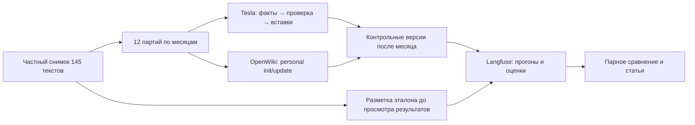

# Подготовка сравнения Tesla и OpenWiki на «Юности — 2024»

Это отдельный исследовательский пакет. Ни один из его CLI не вызывает LLM,
не подключается к серверу и не публикует Wiki. Модель выбрана пользователем:
**gpt-6-luna / medium**, одинаковая для обеих систем. Методика ещё не утверждена.

Начните с [протокола](PROTOCOL.md), затем откройте REVIEW.html в частном снимке.
В [бюджете](BUDGET.md) отдельно указаны известные цены и неизвестные объёмы.

## Что подготовлено

- Проверяемый отбор текстов по московскому времени и 12 месячных партий.
- Неизменяемый частный снимок: исходные строки выбранных постов, provenance,
  действующие промпты Tesla, оригинальный код/промпты OpenWiki, canon,
  Git-архивы обеих систем, хеши, порядок A/B и пустые каталоги повторов.
- 145 заданий на проверку источников, схема атомарного gold, прозрачная рубрика.
  **Gold пока не размечен. Пустой бланк не является готовым benchmark.**
- Малый Responses-адаптер Tesla: тот же компилятор и схемы, без запасных моделей,
  с полными JSON запросами/ответами и сохранением неудач. Fake-тесты не требуют ключей.
- Проверка штатного raw reader и personal-промптов OpenWiki с синтетическим входом
  и запрещённой сетью. Это не проверка всего агентного цикла на живой модели.

Результаты выполненных проверок и найденные ограничения — в [RUNTIME_CHECKS.md](RUNTIME_CHECKS.md).
Обнаружено отдельное условие до запуска: действующий canon содержит исторические
уточнения за 2026 год. Решение об исследовательской копии инструкций ожидается;
оригиналы сейчас сохраняются для проверки, их допустимость для строгого корпуса
2024 не заявляется.

## Простая схема работы



Одна модель не означает одинаковые промпты. Мы сохраняем штатные методы и общие
источники, поэтому измеряем различие систем целиком. Сначала проверяем материалы,
потом размечаем gold, затем утверждаем транспорт/расходы и только тогда генерируем.

## Команды подготовки

Из корня проекта, используя отдельный исследовательский Python:

```powershell
$researchPython = '.\storage\experiments\yunost-2024\runtime-python\Scripts\python.exe'
& $researchPython -m unittest discover -s experiments/wiki-quality/yunost-2024 -p 'test_*.py' -v
& $researchPython experiments/wiki-quality/yunost-2024/prepare.py freeze
& $researchPython experiments/wiki-quality/yunost-2024/prepare.py verify '<путь к снимку>'
& $researchPython experiments/wiki-quality/yunost-2024/prepare.py preflight '<путь к снимку>'
```

`preflight` намеренно возвращает ready_for_generation=false и exit 2: подписанных
материалов/gold/бюджета ещё нет. Редактирование JSON-флага не разрешает запуск;
живого запускающего CLI в этом пакете нет.

`freeze` пишет в `storage/experiments/yunost-2024/snapshots/<hash>/`.
Повтор при неизменных входах проверяет тот же пакет. Изменённый пакет не принимается.
Для разметки копируйте бланки в отдельный рабочий каталог; после утверждения
эталон получает собственную версию и ссылку на исходный snapshot_id.

OpenWiki checkout находится в `storage/experiments/yunost-2024/vendor/openwiki`.
Зависимости устанавливаются `pnpm install --frozen-lockfile --ignore-scripts`,
сборка — штатной командой `pnpm run build`. После успешной сборки:

```powershell
node experiments/wiki-quality/yunost-2024/openwiki_fixture.mjs `
  storage/experiments/yunost-2024/vendor/openwiki `
  storage/experiments/yunost-2024/fixture-<новое имя>
```

Fixture требует нового каталога, сохраняет отчёт и исходные составленные
системные промпты. Скрипты установки зависимостей отключены; если штатная нативная
зависимость не соберётся, это фиксируется как незавершённая проверка, а не обходится
подменой реализации OpenWiki.

Полная механическая проверка Tesla выполняется на Linux с python-dotenv 1.2.4:

```sh
python experiments/wiki-quality/yunost-2024/tesla_fixture.py \
  storage/experiments/yunost-2024/fixture-tesla-NEW
```

Для отдельного runner можно передать `--native-archive /path/to/tesla.tar`:
проверяются Git commit в pax header и SHA-256 архива в отчёте.
Две синтетические партии прошли на Linux. На Windows тот же штатный ingest
отклоняет второе обновление из-за CRLF/LF и хешей; его нельзя использовать для
измерений без отдельного исправления и смены исследуемой версии.

Фикстуры никогда не являются экспериментальными результатами качества.

## Что хранится в Git и что остаётся частным

Git содержит код подготовки, протокол и тесты. Исходные посты, prompts overrides
из админки, частный gold, архивы и будущие результаты находятся в игнорируемом
`storage/experiments/`. Снимок сохраняет копии файлов подготовки и их хеши,
а также commit HEAD подготовившего репозитория. GitHub сам по себе этих данных
не содержит. Для независимого воспроизведения понадобится отдельно разрешённый
доступ к частному пакету и модели.

Существующий production ingest, рабочая Wiki, ledger, реестр промптов, расписание
и сайт этим пакетом не изменяются. Fingerprint проверяет Wiki, admin DB, ledger
и их SQLite sidecar-файлы до и после подготовки.
